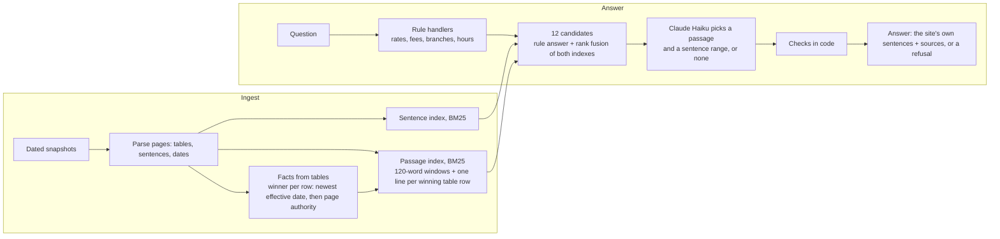

# Time-aware Q&A over a credit union's public website: retrieval and extractive LLM selection

A question-answering system over several dated crawls of a credit union's public website. It answers member
questions ("What is the 36-month certificate rate?", "How do I report a lost card?") with the **current** value,
the **right** tier and a **source**, and says "I don't know" when the site does not say.

The first version was rule-based with no model calls (tag `rules-baseline`). This repository adds a retrieval layer
and a narrow LLM step that only *selects* website text, and measures each addition on held-out questions.

**Result on the sealed, held-out test set (326 questions): 0.38 to 0.69.** The number is the composite score of
the scorer that came with the task (accuracy 55%, consistency 15%, speed 15%, conflict list 15% where a set has
conflict labels); an answer that repeats an out-of-date value scores zero for that question.

| Question set | Rules only | + retrieval and LLM selector | + document expansion |
|---|---|---|---|
| Generated test set, 326 questions, sealed during tuning | 0.382 | 0.664 | **0.693** |
| Earlier blind set, 68 questions, sealed during tuning | 0.642 | 0.772 | 0.778 |
| Control set, 50 questions written by a different model | 0.566 | 0.806 | 0.849 |
| Refusal questions in the test set (41) | 0.36 | 0.71 | 0.75 |
| p95 answer time (test set) | 0.05 s | 1.2 s | 1.0 s |

All question sets are held-out from tuning but none is independent of language models; see "Evaluation method".
On the task's 40 practice questions the score is 0.946 before and after: the rules already handled those.

## How it works



The editable diagram is `docs/architecture.drawio`. `docs/TASK.md` describes the task and its scoring;
`submission/NOTES.md` describes the rule-based system in detail. `git diff rules-baseline` shows what this work
added.

**1. Conflicts are settled at index time.** Every table cell becomes a fact with a page, an effective date and
a page authority. For each table row one fact wins. Only winning rows go into the passage index, so an old rate
on a stale page is never a candidate and the model does not have to judge which value is current.

**2. The model selects; it does not write.** It gets the question and 12 numbered passages and returns a passage
id and a sentence range. The answer text is always copied from the website, so every number in an answer exists
on the site. There is no free-text generation.

**3. The rule answer competes as passage 1.** Rule handlers are precise on rates and fees but miss unusual
wordings. Their answer is shown to the model next to retrieved passages; the model keeps it or picks a better
one. Questions that need a whole table ("do any tiers pay 0.35%?") skip this step.

**4. Refusals are checked three ways.** The model can say "none". A question that asks for an amount, a count
or a percentage is refused when the picked passage contains no such figure. A "none" on the newest snapshot is
final.

**5. Rails.** 1.8 s timeout per call, a time budget per answer, a circuit breaker, a disk cache keyed on
everything the model sees, and a spend cap. Any failure returns the rule-based answer. With the layer off
(the default) the output is byte-identical to the rule-only system; `tests/test_llm_off.py` checks this against
the tag `rules-baseline`.

Retrieval in the default configuration is lexical: two BM25 indexes merged by weighted reciprocal rank fusion.
An embedding retriever is implemented and measured, and is off by default (below).

## What I measured and changed

**Where answers were lost.** `tools/recall_stats.py` splits wrong answers into "the answer was not among the
candidates" and "it was there but not chosen". At the start the answer was among the 12 candidates for 52% of
dev questions. Most misses were rate-table rows (the tables were not in the text index at all) and answers
spread over several sentences. After adding table rows and passage windows it was 78% (dev).

**Where the time went.** Calls took 1.4 s at the median and timed out against the 2 s limit. Halving the prompt
did not change that. Timing five request shapes showed that the JSON-schema output format added about 0.6 s to
the first token. A one-line text reply checked in code takes 0.75 s.

**Short written reasoning helps.** With thinking switched off, the model still wrote a few sentences before
hard picks, and those picks were better. A fixed three-line reply (`asks:` / `check:` / `pick:`) keeps that at
a median of 1.0 s per call.

**Three ways to find answers worded differently from the question** (dev set):

| Added retriever | Recall@12 | Final |
|---|---|---|
| None (two BM25 indexes) | 0.784 | 0.715 |
| Local embedding model (bge-small), weight 0.3 in the fusion | 0.821 | 0.709 |
| Document expansion: Claude Haiku writes three questions per passage, offline | 0.850 | **0.743** |
| Expansion and embeddings | 0.867 | 0.747 |
| Expansion, then a local cross-encoder over the first 50 results | 0.870 | not run: +0.6 s per answer |

Document expansion costs $0.36 once for 9,129 passages (Batch API) and nothing at answer time. The embedding
retriever found more answers, but the selector did not turn them into more correct answers, so it is off by
default. Embeddings alone were much weaker than BM25 here (recall@12 0.62 against 0.78): the questions are full
of product names and numbers.

How much expansion helps depends on who wrote the questions. The expansion questions and the generated test set
are both written by a model from the same pages: +2.9 points there, +0.6 on the earlier blind set, +4.3 on the
50-question control set (one question is 2 points on that set).

**Ablations** (dev set, 345 questions, final score, without document expansion):

| Variant | Final |
|---|---|
| Rules only | 0.418 |
| LLM selector over sentence candidates only (the first version) | 0.565 |
| Full system | **0.715** |
| Full, without the passage index | 0.638 |
| Full, without review of rate and fee answers | 0.636 |
| Full, without the reasoning lines | 0.682 |

**What is still lost.** `docs/FAILURE_ANALYSIS.md`: with expansion the answer is missing from the candidates for
15% of dev questions; 42% of those are answers longer than one passage, the rest are ranking.

## Evaluation method

- **Question sets.** 245 questions in four sets written during the rule-based phase; 671 questions generated by
  Claude Opus (Batch API) from website pages only, never from the system, each verified against the pages by a
  second pass; 50 control questions written by Claude Sonnet in a separate session that could read only the
  snapshots. Paraphrase groups stay on one side of the dev/test split.
- **Sealed sets.** Half of the generated questions and one of the four earlier sets were only run at milestones,
  and only aggregate scores were read. All tuning used the dev half. The dev score (0.743) is higher than the
  test score (0.693); the difference is the amount of fitting to dev.
- **A defect found in the gold answers.** 12 generated items had a table footnote digit glued to the value
  ("6.49% APR1"), so correct answers scored zero. They were repaired with one fixed pattern; the script prints
  counts only, so the sealed set stayed unread.
- **Cost.** One answer costs about $0.0004 with Claude Haiku. All development, including generating the question
  sets, used about $16.

## Limits

- The rule handlers are written for one website. The retrieval and selection layer is generic, but all numbers
  above come from that one site. On the made-up site in `sample/` the rule-only system answers 17 of 20 questions.
- Every question set was written with a language model's help; none was written by members of a credit union.
- The absolute level is modest: 0.69 on the sealed test set.
- No deployment, no service, no users: this is a library with a scorer.

## Run it

Without any data or API key, on the made-up sample site:

```bash
python harness/run_eval.py --submission submission --snapshots sample/snapshots \
    --eval sample/eval.jsonl --conflicts-gold sample/conflicts_gold.json --out results_sample
python -m unittest discover -s tests     # 176 tests; those that need the real snapshots skip without them
```

The rule-based system needs only the Python standard library (tested on Python 3.14). CI runs both commands.

With the real snapshots (not redistributed here; put the task's `snapshots_zip/` folder in the repository root)
and the LLM layer:

```bash
python -m venv .venv && .venv/bin/pip install -r submission/requirements-llm.txt
DUPACO_LLM=answer ANTHROPIC_API_KEY=... .venv/bin/python harness/run_eval.py --submission submission --eval dev/open_eval.jsonl

# document expansion: one Batch API job (about $0.36), then switch it on
.venv/bin/python tools/expand_passages.py
DUPACO_LLM=answer DUPACO_EXPAND=on DUPACO_LLM_CACHE_DIR=.llm_cache ANTHROPIC_API_KEY=... \
    .venv/bin/python harness/run_eval.py --submission submission --eval dev/open_eval.jsonl
```

| Path | What |
|---|---|
| `submission/solution.py`, `kb.py` | parsing, facts, rule handlers, conflict list |
| `submission/passages.py` | passage index, rank fusion, optional expansion and embeddings |
| `submission/llm.py` | the selector call and its rails |
| `harness/` | the task's scorer, unchanged |
| `sample/` | made-up site, questions and conflict label |
| `tools/recall_stats.py`, `tools/miss_analysis.py` | retrieval and selection breakdown |
| `tools/milestone.py` | scores several sets in one mode; ablation switches |
| `tools/expand_passages.py` | document expansion (one Batch API job) |
| `tools/evalgen/` | question generation, verification, split |
