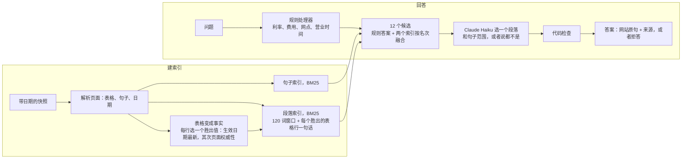

# 带时间意识的网站问答：检索 + 抽取式 LLM 选择

[English](README.md) | **中文**

[](https://github.com/inosven/extractive-rag-credit-union/actions/workflows/tests.yml)

一个问答系统，数据是一家信用社公开网站在不同日期的多次抓取。它回答会员的问题（"36 个月定期的利率是多少？"
"银行卡丢了怎么挂失？"），给出**当前**的数值、**正确**的档位和**来源**；网站没写的，就回答"不知道"。

第一版是纯规则的，不调用任何模型（标签 `rules-baseline`）。这个仓库在它之上加了一层检索和一个很窄的 LLM 步骤：
模型只*选择*网站上的文字，不自己写。每加一样东西，都在没参与调参的题目上量过效果。

**封存测试集（326 题）上的结果：0.38 → 0.69。** 这个数字是任务自带评分器的综合分（准确率 55%、一致性 15%、
速度 15%、冲突清单 15%，后者只在题集带冲突标注时计入）；答案里出现过时的数值，这道题得 0 分。

| 题集 | 只有规则 | + 检索和 LLM 选择器 | + 文档扩展 |
|---|---|---|---|
| 生成的测试集，326 题，调参期间封存 | 0.382 | 0.664 | **0.693** |
| 早期的盲测集，68 题，调参期间封存 | 0.642 | 0.772 | 0.778 |
| 对照集，50 题（见"评测方法"） | 0.566 | 0.806 | 0.849 |
| 测试集里应当拒答的题（41 题） | 0.36 | 0.71 | 0.75 |
| 答题耗时 p95（测试集） | 0.05 秒 | 1.2 秒 | 1.0 秒 |

所有题集都没有参与调参，但没有一套是与语言模型无关的，见"评测方法"。
任务自带的 40 道练习题前后都是 0.946：这些题规则版本来就能答对。

## 工作原理



可编辑的图在 `docs/architecture.drawio`。`docs/TASK.md` 说明任务和评分方式；`submission/NOTES.md` 详细说明规则版。
`git diff rules-baseline` 可以看到这次工作加了什么。

**1. 冲突在建索引时裁决。** 每个表格单元格变成一条事实，带着页面、生效日期和页面权威性。每个表格行只有一条
事实胜出。只有胜出的行进入段落索引，所以旧页面上的旧利率不会成为候选，模型不需要判断哪个值是当前的。

**2. 模型只选不写。** 它拿到问题和 12 个编了号的段落，返回一个段落编号和句子范围。答案的文字永远是从网站上
抄下来的，所以答案里的每个数字都真实存在于网站上。没有自由生成。

**3. 规则答案作为第 1 个候选参与竞争。** 规则处理器在利率和费用上很准，但遇到少见的问法会漏。它的答案和检索到
的段落一起给模型看，模型保留它或者选一个更好的。需要看整张表的问题（"有没有哪档利率是 0.35%？"）跳过这一步。

**4. 拒答有三道检查。** 模型可以说"都不是"。问金额、数量或百分比的题，如果选中的段落里没有这类数字，就拒答。
在最新快照上得到"都不是"之后，不再去旧快照重问。

**5. 护栏。** 每次调用 1.8 秒超时，每道题有时间预算，有熔断、磁盘缓存（键包含模型看到的全部内容）和花费上限。
任何失败都退回规则答案。LLM 层关闭时（默认），输出与规则版逐字节相同；`tests/test_llm_off.py` 对照标签
`rules-baseline` 检查这一点。

默认配置下检索是词法的：两个 BM25 索引，用带权重的 reciprocal rank fusion 合并。向量检索已实现并测过，默认关闭（见下）。

## 量了什么，改了什么

**答案丢在哪里。** `tools/recall_stats.py` 把答错的题分成"答案不在候选里"和"在候选里但没被选中"。一开始，开发集
只有 52% 的题答案在 12 个候选里。漏掉的大多是利率表的行（表格根本不在文本索引里）和跨好几句话的答案。加上
表格行和段落窗口之后是 78%（开发集）。

**时间花在哪里。** 模型调用的中位数是 1.4 秒，在 2 秒时限下经常超时。把提示词减半没有用。对五种请求形式分别计时
后发现，JSON schema 输出格式让第一个 token 多等约 0.6 秒。改成一行纯文本、由代码校验后是 0.75 秒。

**简短的书面推理有用。** 关掉 thinking 之后，模型在难题上仍会先写几句话，而且这些题选得更准。固定的三行回复
（`asks:` / `check:` / `pick:`）保留了这个好处，调用中位数 1.0 秒。

**问法和网页措辞不同时，怎么找到答案：三种办法**（开发集）：

| 加的检索方式 | Recall@12 | 综合分 |
|---|---|---|
| 不加（两个 BM25 索引） | 0.784 | 0.715 |
| 本地向量模型（bge-small），融合权重 0.3 | 0.821 | 0.709 |
| 文档扩展：Claude Haiku 离线给每个段落写三个问题 | 0.850 | **0.743** |
| 文档扩展 + 向量 | 0.867 | 0.747 |
| 文档扩展，再用本地 cross-encoder 重排前 50 个结果 | 0.870 | 没跑：每题多 0.6 秒 |

文档扩展对 9,129 个段落一次性花费 0.36 美元（Batch API），答题时不花钱也不花时间。向量检索多找回了一些答案，
但选择器没有把它们变成更多的正确答案，所以默认关闭。单独用向量比 BM25 差很多（recall@12 0.62 对 0.78）：
这里的问题满是产品名和数字。

文档扩展的收益取决于题目是谁写的。扩展用的问题和生成的测试集都是模型按同一批页面写的：在那套题上涨 2.9 分，
在早期盲测集上涨 0.6 分，在 50 题对照集上涨 4.3 分（那套题一道就是 2 分）。

**消融实验**（开发集，345 题，综合分，不含文档扩展）：

| 版本 | 综合分 |
|---|---|
| 只有规则 | 0.418 |
| 只在句子候选上做 LLM 选择（第一版） | 0.565 |
| 完整系统 | **0.715** |
| 完整，去掉段落索引 | 0.638 |
| 完整，利率和费用答案不交给模型复核 | 0.636 |
| 完整，去掉推理行 | 0.682 |

**还丢在哪里。** 见 `docs/FAILURE_ANALYSIS.md`：开了文档扩展后，开发集仍有 15% 的题答案不在候选里；其中 42% 是
答案比一个段落长，其余是排名问题。

## 评测方法

- **题集。** 规则版阶段写的四套共 245 题；Claude Opus（Batch API）只根据网页生成的 671 题，生成时看不到系统，
  每道题由第二遍对照网页核对；Claude Sonnet 5.5 在单独的会话里写的 50 道对照题，它只能读快照和评分器（一道题
  2 分；部分来源页面是手挑的，不是抽样）。Sonnet 5.5 也做过生成题集的核对，所以这套题同样不是独立的。
  同一个问题的不同问法始终留在开发集或测试集的同一边。
- **封存的题集。** 生成题的一半和早期四套中的一套只在里程碑时跑，而且只看汇总分。所有调参都用开发集那一半。
  开发集分数（0.743）高于测试集（0.693），差距就是对开发集的拟合程度。
- **标准答案里发现的一个缺陷。** 12 道生成题的标准值后面粘着表格脚注的数字（"6.49% APR1"），答对也得 0 分。
  用一条固定的模式修复；脚本只打印计数，所以封存的题集始终没有被读过。
- **成本。** 用 Claude Haiku，一个答案约 0.0004 美元。全部开发（包括生成题集）花了约 16 美元。

## 局限

- 规则处理器是为一个网站写的。检索和选择层是通用的，但上面所有数字都来自这一个网站。在 `sample/` 里那个
  虚构的站点上，规则版答对 20 题中的 17 题。
- 每套题都有语言模型参与，没有一套是信用社的真实会员写的。
- 绝对水平不高：封存测试集 0.69，比调参用的开发集（0.743）低约 5 分。
- 没有部署，没有服务，没有用户：这是一个库加一个评分器。

## 运行

不需要任何数据和 API key，在虚构的样例站点上：

```bash
python harness/run_eval.py --submission submission --snapshots sample/snapshots \
    --eval sample/eval.jsonl --conflicts-gold sample/conflicts_gold.json --out results_sample
python -m unittest discover -s tests     # 176 个测试：70 个不需要网站数据，106 个需要快照、会跳过
```

规则版只需要 Python 标准库（在 Python 3.14 上测过）。CI 跑的就是这两条命令。

有真实快照（这里不分发；把任务提供的 `snapshots_zip/` 文件夹放到仓库根目录）并打开 LLM 层：

```bash
python -m venv .venv && .venv/bin/pip install -r submission/requirements-llm.txt
DUPACO_LLM=answer ANTHROPIC_API_KEY=... .venv/bin/python harness/run_eval.py --submission submission --eval dev/open_eval.jsonl

# 文档扩展：一次 Batch API 任务（约 0.36 美元），然后打开开关
.venv/bin/python tools/expand_passages.py
DUPACO_LLM=answer DUPACO_EXPAND=on DUPACO_LLM_CACHE_DIR=.llm_cache ANTHROPIC_API_KEY=... \
    .venv/bin/python harness/run_eval.py --submission submission --eval dev/open_eval.jsonl
```

| 路径 | 内容 |
|---|---|
| `submission/solution.py`、`kb.py` | 解析、事实、规则处理器、冲突清单 |
| `submission/passages.py` | 段落索引、名次融合、可选的文档扩展和向量检索 |
| `submission/llm.py` | 选择器调用和护栏 |
| `harness/` | 任务自带的评分器，未改动 |
| `sample/` | 虚构站点、题目和冲突标注 |
| `tools/recall_stats.py`、`tools/miss_analysis.py` | 检索和选择的失分分解 |
| `tools/milestone.py` | 一次给多套题打分；消融开关 |
| `tools/expand_passages.py` | 文档扩展（一次 Batch API 任务） |
| `tools/evalgen/` | 题目生成、核对、切分 |

## 许可

本项目自己写的代码和文档采用 MIT 许可，见 `LICENSE`。它不覆盖 `harness/`（任务自带的评分器，原样收录），
也不覆盖 `dev/` 题集里引用的网站内容。

其余文档（`docs/`、`submission/NOTES.md`、`sample/README.md`）只有英文。
